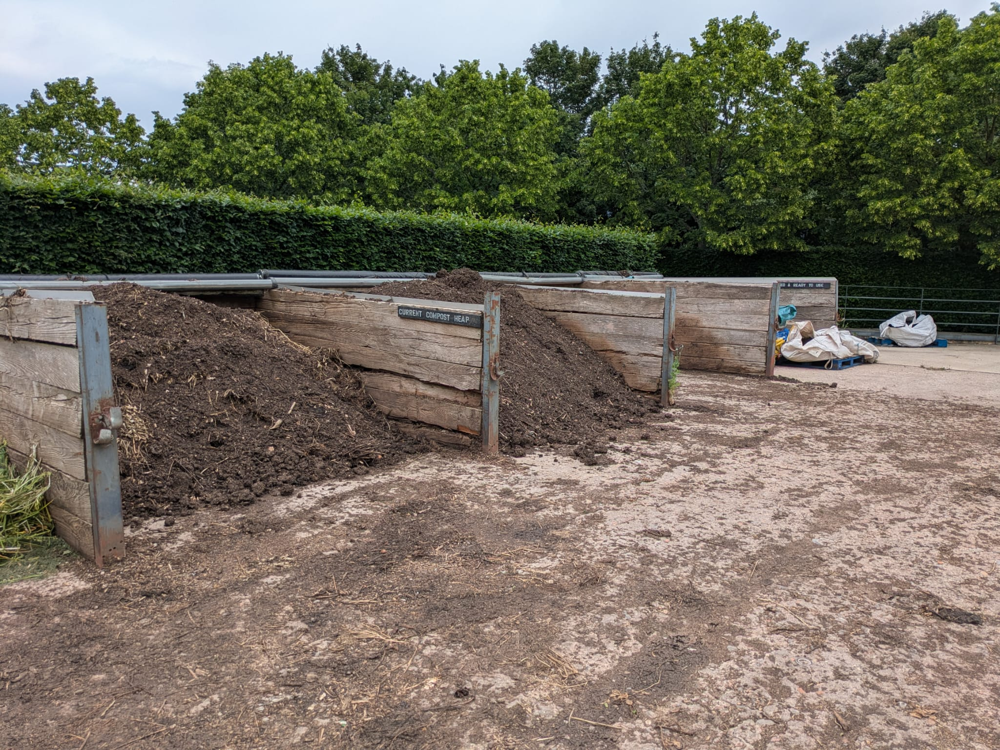
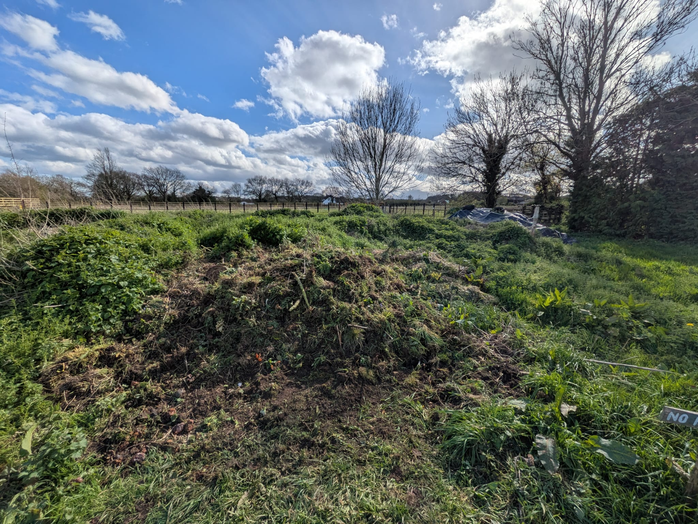
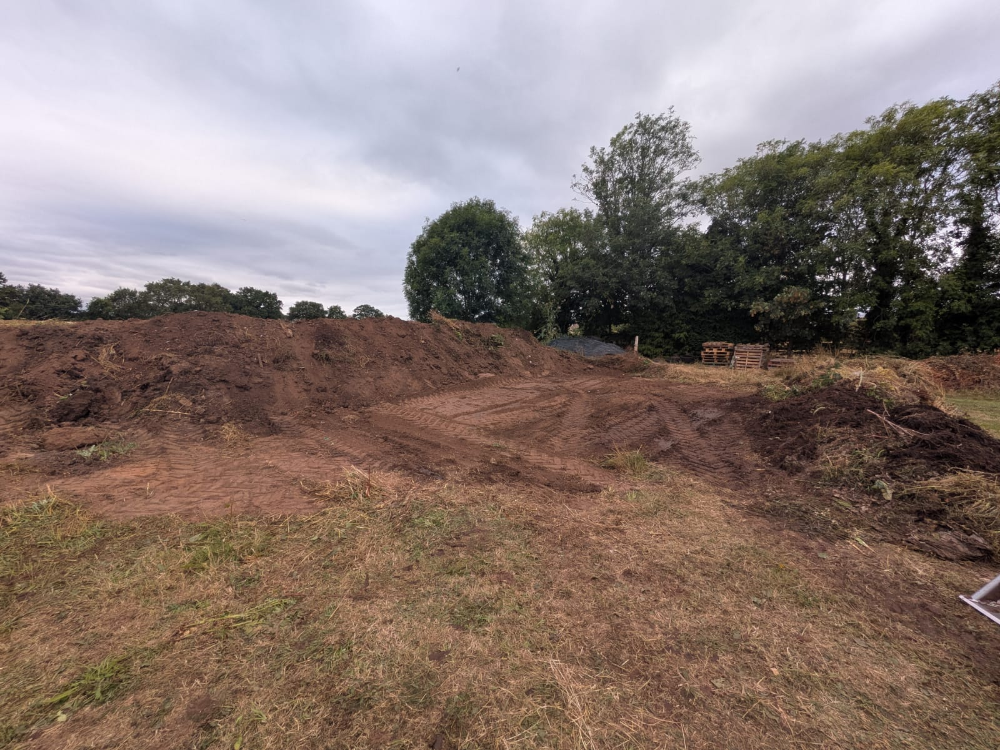
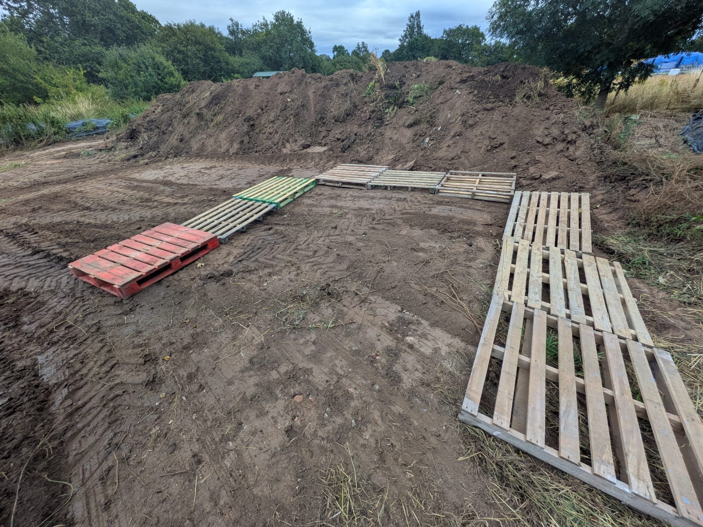
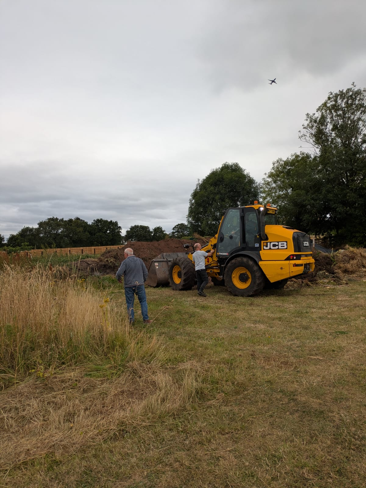

The sight of bare earth, piled materials, and heavy machinery at our allotment recently marked the beginning of an exciting new chapter in our composting journey. After months of planning, we've finally begun constructing a dedicated composting system that will transform how we manage garden waste and create rich compost for our growing beds.

> **The Vision: Four 3x3 Pallet Bays:** Our goal is straightforward but ambitious: build four composting bays, each measuring 3 meters by 3 meters, using reclaimed wooden pallets. This system will give us better organization, improved airflow, and the capacity to manage multiple stages of the composting process simultaneously. But before we could start assembling, we had to prepare the ground.

Over the past year, members of our allotment team have visited commercial composting sites and touring gardens across the country. What we observed at these larger operations was eye-opening. Professional gardeners and waste management facilities have long understood the benefits of large scale bay systems, organized, efficient, and highly productive. They use substantial bays to manage different stages of decomposition, rotating materials systematically to produce high-quality finished compost in a fraction of the time it takes with traditional pile methods.

These commercial operations showed us that the bay system isn't just a clever DIY solution, it's a proven, scalable approach used by professionals who take composting seriously. If it works for them, we reasoned, why not adapt the concept for our allotment? We didn't need to replicate their industrial scale, but we could certainly borrow their methodology and apply it to our space.

*Composting bays at [Yeo Valley Organic Gardens](https://www.yeovalley.co.uk/the-organic-garden)*

### 🪏 Clearing and Flattening: The First Challenge

When we surveyed the chosen site, it was clear that nature had claimed it. Large mounds of accumulated soil and compost materials were scattered across the area, and the ground was far from level. As our first image shows, the site needed significant clearing and smoothing before we could lay the foundations for our new bays.

This is where the heavy machinery came in. With a JCB loader on site, our team got to work removing the old piles and redistributing materials to create an even, compact base. The video captures this crucial phase, the JCB working methodically while our volunteers managed the materials and ensured the ground was being leveled properly. It's the kind of unglamorous but essential work that makes the difference between a neat, functional composting system and a chaotic mess.

 

*Before (left) and after (right)*

<video src="/images/articles/composting-july/006.mp4" controls></video>

*Turning the compost bays at the allotment.*

### 🪵 Sourcing the Pallets: A Gift from a Fellow Plot Holder

One of the real highlights of this project has been the generosity of our allotment community. All of the pallets we're using to build the four bays were donated by a fellow plot holder. Rather than sourcing materials from multiple suppliers or scavenging from different sources, we were able to gather everything we needed thanks to their kindness and foresight.

We've been given quite an array of natural wood pallets, red-painted ones, and green and yellow striped versions. Each pallet will find its purpose in building the bays, and the variety adds a splash of color to the site. This donation not only saved us significant expense but also embodied the collaborative spirit that makes our allotment special. It's a reminder that our greatest resource isn't materials or machinery, it's the people who share this space and support one another's projects.

Using reclaimed pallets is both economical and sustainable. Rather than purchasing new timber, we're giving a second life to materials that would otherwise be discarded. It's very much in keeping with the allotment spirit.

### 👍 A Simple, Effective Approach

Our composting method is refreshingly straightforward. We'll fill one bay completely with garden waste and kitchen scraps, then cover it to protect the materials and retain moisture and heat. Once that bay is full, we'll leave it undisturbed to break down naturally. Then we'll move on to fill the second bay, and so on. By the time we've filled the fourth bay, the first will be well on its way to producing finished compost, ready for harvesting.

This approach is less labor-intensive than traditional turning methods, while still delivering excellent results. By using multiple bays, we create a natural rotation system that means we always have compost at different stages of readiness; some fresh and actively decomposing, others mature and ready to use. It's efficient, manageable, and proven effective at scale.

*Laying out some pallets to ensure they fit the space*

### ⏭️ What's Next?

With the site now cleared and flattened, we're ready to begin the satisfying work of construction. Our four 3x3 bays will create distinct zones for managing garden waste at different stages of decomposition. This system mirrors the approach used by professional gardeners and composting operations, just adapted to suit our allotment's needs and resources.

The pallet bay system offers numerous advantages: excellent drainage and airflow to speed decomposition, a defined space that looks organized and intentional, and the flexibility to adjust or expand if needed. Plus, at ground level, it's much easier to access materials for loading and harvesting finished compost than it would be from a sprawling pile.

### 🌻 Building Community Through Composting

What strikes us most about this project isn't just the end result though we're excited about that—but the community effort it represents. From a generous donation of pallets to operating heavy machinery to getting hands dirty during site prep, this is a shared endeavor. Every member of our allotment has contributed something, and that collaborative spirit is what makes our growing space special.

Over the coming weeks, we'll be documenting the construction phase as those pallets transform into functional composting bays. Our waste-to-gold system is nearly ready to launch.

