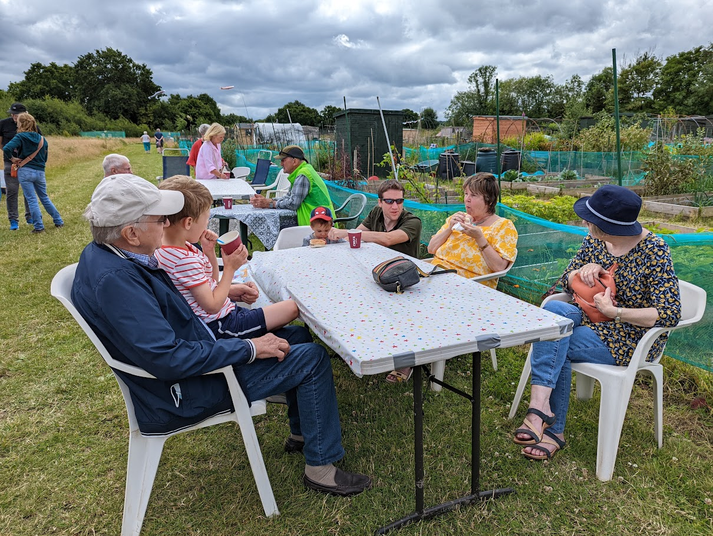
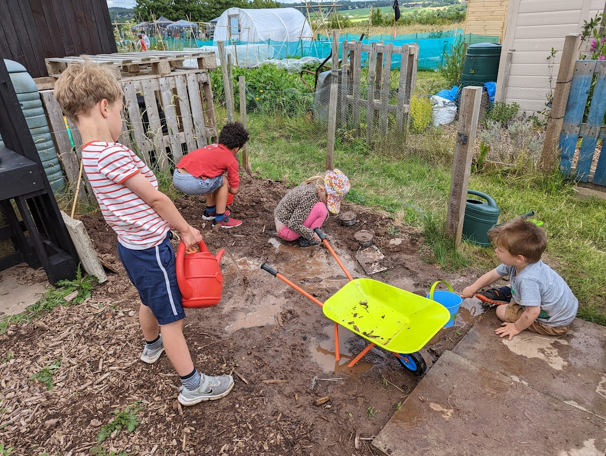
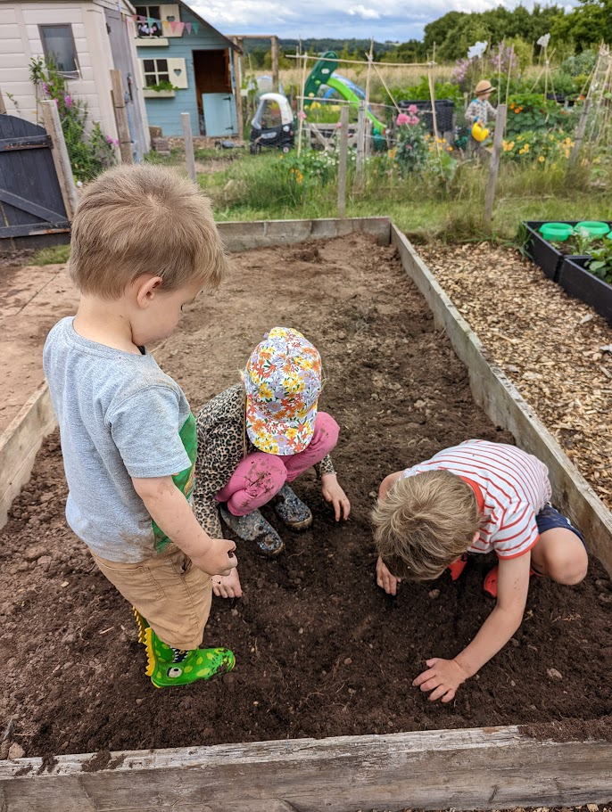
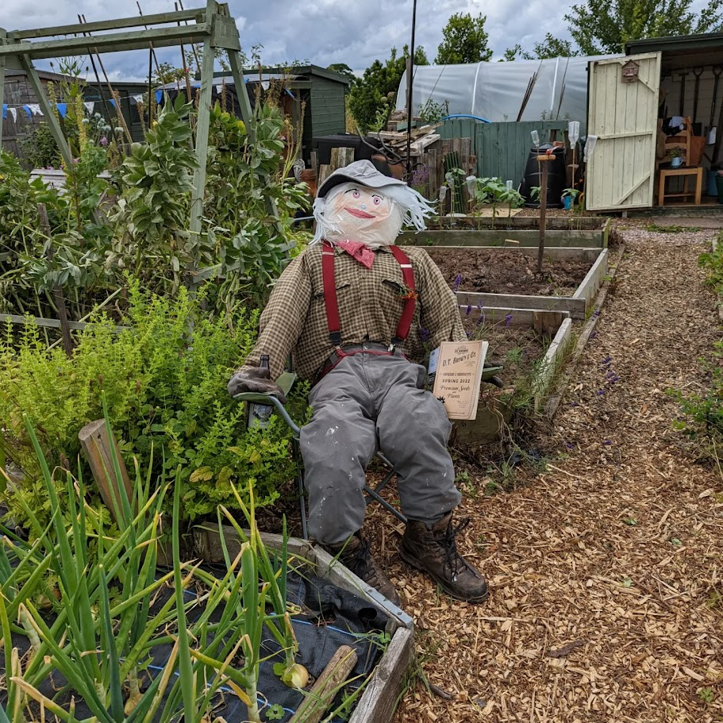

This past weekend, our allotment was buzzing with life as we hosted our much-anticipated Annual Open Day. With the weather staying dry and interspersed with moments of sunshine - it was the perfect setting for a day of community, creativity, and, delicious treats.

  

## What Made the Day Special

### 🎫 Exciting Raffle and Generous Prizes

The raffle was another big draw! Thanks to the generosity of local businesses and our community members, we had a wide range of fantastic prizes up for grabs. The raffle money raised will go towards maintaining Townfield Allotments and supporting future events for the community.

### 🎂 Sweet Treats & Savoury Bites

The cake stall was a hit and had sold out before the end! We have some talented bakers among us!

Over at the ever popular BBQ, the demand was high and the grilling team did a fantastic job powering through it all with a smile.

Paired with a cup of hot tea or coffee, it was the perfect way to relax and enjoy the surroundings.

### 👧 A Day of Community and Connection

What truly made the day special was the sense of community. It was wonderful to see so many people—long-time members, new plot holders, and visitors—coming together to celebrate our shared love of growing, nature, and the outdoors. There was much swapping of tips, sharing of stories, and admiring of each other's plots.

### 🌻 A Scarecrow Trail to Remember

**This year marked the debut of our Scarecrow Trail**, and our members truly rose to the occasion, creating an incredible assortment of scarecrows that were as imaginative as they were entertaining. From dinosaurs to Tin Man, Super Worm to Jürgen Klopp - there were many delightful characters to discover.

Children (and quite a few adults!) had a fantastic time exploring the allotments, trying to solve the scarecrow's anagram! The excitement on the kids' faces as they completed the trail and received their well-earned sweet (or two!) was lovely to see. It was a fantastic start for what we hope will become a fun-filled tradition for years to come.

> **A huge thank you to everyone who contributed.** Whether you did the heavy lifting, baked a cake, crafted a scarecrow, donated a raffle prize, or simply came along to enjoy the day - we couldn't have done it without you - reminding us all why our allotment is such a special place.
