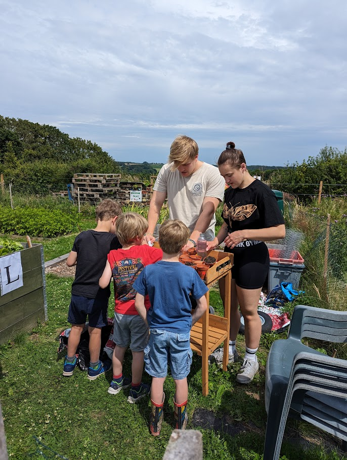
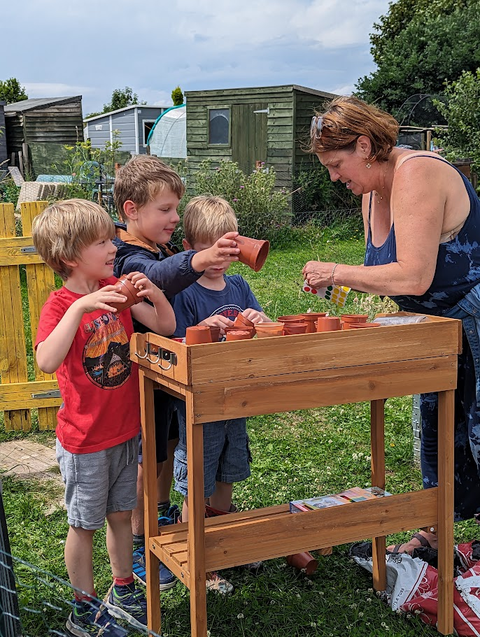
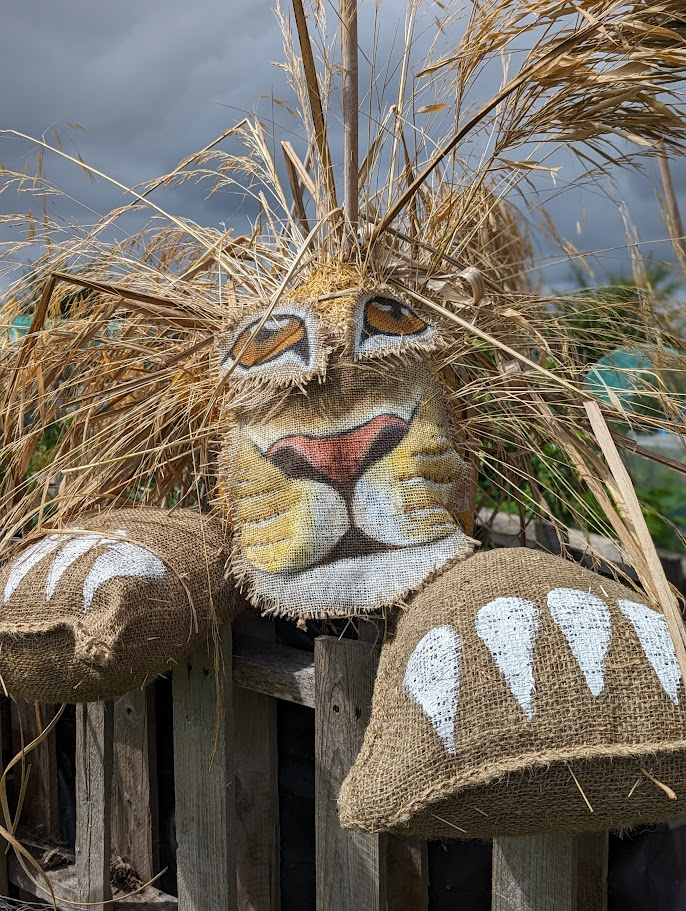

This past weekend, our allotment was alive with activity as we hosted our much-anticipated Annual Open Day. After a threatening start, the weather was very kind to us and the looming storms held off until the very moment the last of us were packing away after another fun-filled, successful day!

## Cultivating Curiosity

This year, Andrea and John, two volunteers on the Wellness plot, kindly introduced a new hands-on activity for kids: seed pot sowing. It was an instant hit with our youngest visitors!

Children were invited to plant their own seeds in small pots, learning about the plants and how to care for them. They could then decorate their pots with stickers, bringing their creations to life. It was delightful to witness the curiosity and excitement as they got their hands dirty, planting seeds and imagining the plants they would grow. Many children proudly took their pots home, to continue their growing journey.

This new addition was both entertaining and educational for our budding gardeners, making it a delightful and enriching experience for everyone.

 

## What Made the Day Special

### 🎫 Raffle

The raffle was a major highlight as always, showcasing a fantastic range of prizes generously donated by local businesses and community members. The proceeds will go towards maintaining Townfield Allotments and supporting future community events, helping to ensure the continued occurrence of our annual gathering for all to enjoy.

### 🎂 Cake Station

Our cake stall was once again a resounding success, with every delicious treat sold out before the day's end. Our talented bakers truly outdid themselves this year!

### 🍔 BBQ!

Over at the ever-popular BBQ, the team worked cheerfully and tirelessly as always - satisfying many hungry bellies! Not an easy task but very much appreciated!

### 🌻 A Scarecrow Trail to Remember

Our Scarecrow Trail made a triumphant return this year, with our members once again showcasing their incredible creativity and flair. From an enchanting fairy, to a crafty crow, a kingly lion to a scarecrow feeling the need to weed!, the trail was a delightful adventure for all. Once again children scampered off eager to solve the scarecrow's anagram along the way! This event is undoubtedly becoming a cherished tradition.

> **A huge thank you to everyone who contributed.** Whether you did the heavy lifting, baked a cake, crafted a scarecrow, donated a raffle prize, or simply came along to enjoy the day - we couldn't have done it without you - reminding us all why our allotment is such a special place.
