We couldn't have asked for a better day as our annual Allotment Day wrapped up summer with glorious weather and an incredible turnout. The community came together to celebrate all that makes our allotment special.

> **Thank you to our amazing sponsors and volunteers** who made this day possible: Motor World, Whitmore & White, Libby's Wine, Greyturtle Digital Marketing, Flourish of Sutton Weaver Florists, Costa, Gleaves, Rotary Club, and all our generous community members!

## What Made the Day Special

### 🎫 Raffle

The raffle was one of the most anticipated events of the day, bringing plenty of excitement and support from the community. Huge thanks to all our generous sponsors!

### 🎂 Cake Station

A bounty of delicious homemade cakes from our allotment holders, plus a fantastic barbecue thanks to Rotary Club. The sizzling aroma was mouth-watering!

### 🌻 Scarecrow Trail

Families loved uncovering the hidden anagram—sunflower seeds—as they explored the allotments visiting each plot to spot the inventive scarecrows crafted by our talented community members. A delightful way to engage everyone, young and old!

### 👧 Kiddies Corner

Making its debut this year, Kiddies' Corner was a huge hit with families, offering a range of activities that kept little ones entertained. The sun-catcher butterfly wings added a splash of color, while rock painting and bulb planting allowed children to get creative and hands-on with nature.

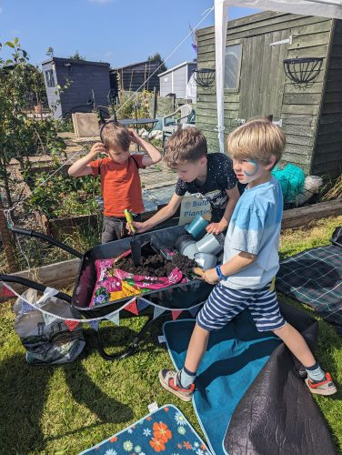

## Activities & Highlights

### 🎨 Face Painting

From beautiful butterflies to fierce tigers, our talented face painters brought smiles to everyone who stopped by. It was lovely to see so many colourful faces around the allotment!

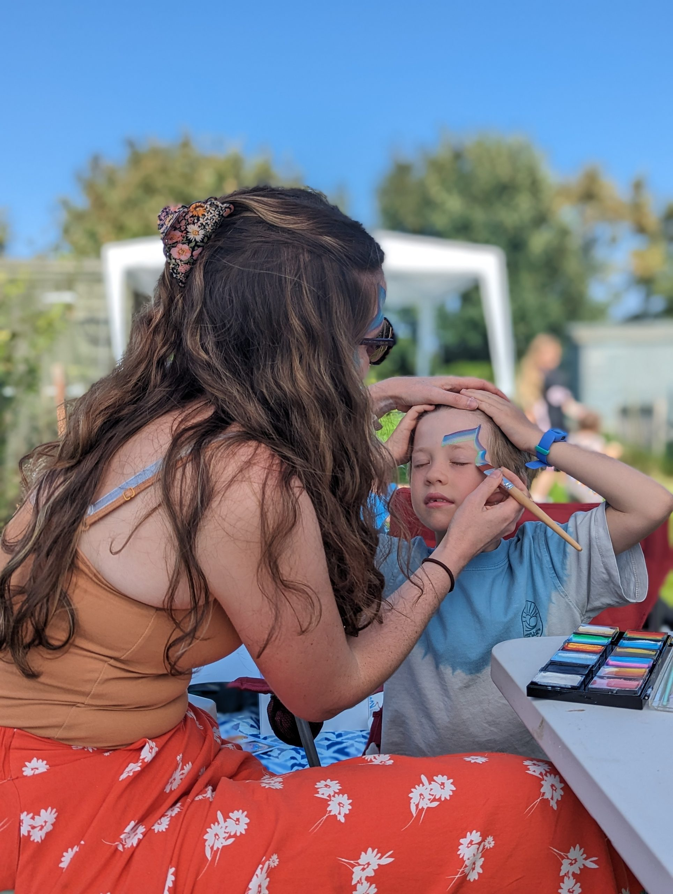

### 🪨 Rock Painting

A big thank you to **@FrodshamRocks** for hosting this hugely popular activity! Young visitors had a fantastic time unleashing their creativity onto their chosen rocks and each went home with their own precious keepsake from the day.

*Keep your eyes peeled when wandering around Frodsham for any more #FrodshamRocks hidden gems!*

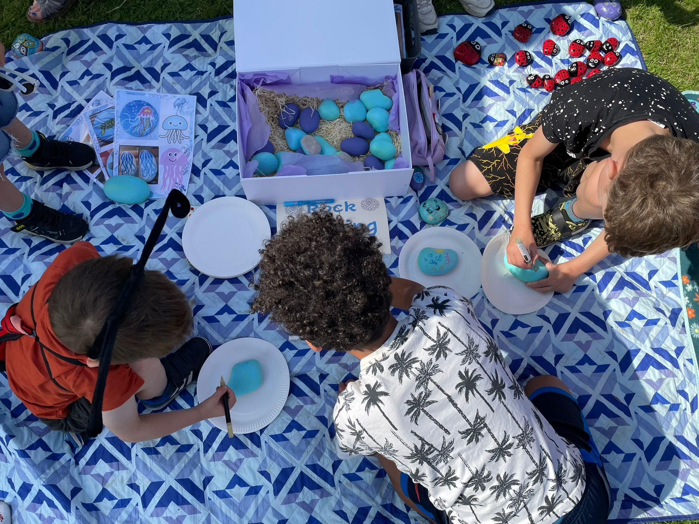 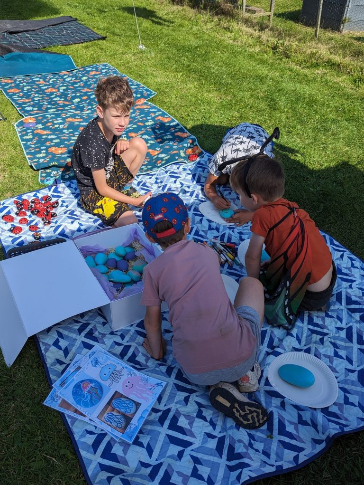 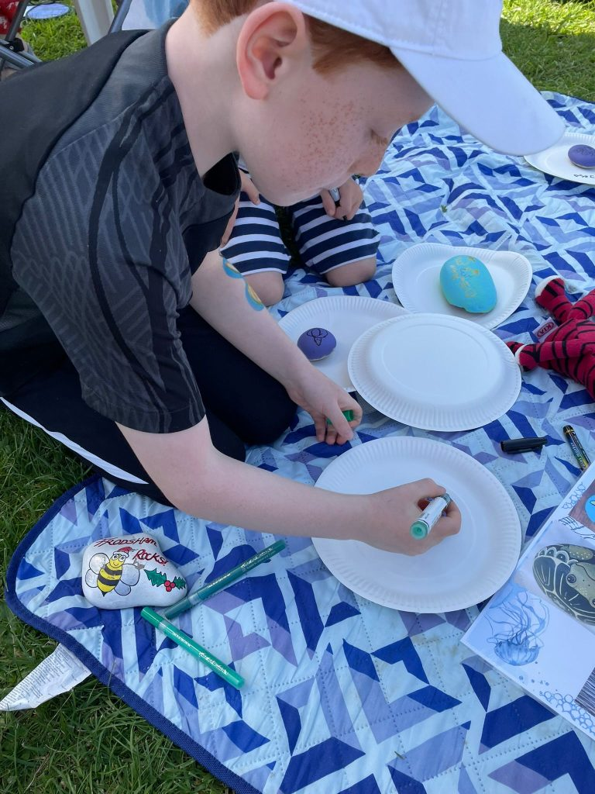 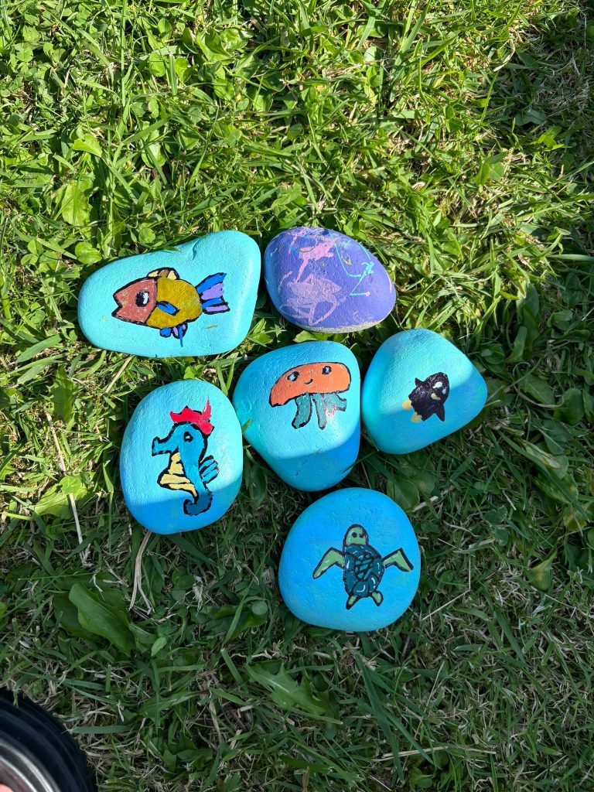

### 🦋 Suncatcher Butterfly Wings

Children had a wonderful time bringing their own set of butterfly wings to life. The vibrant translucent materials of the suncatchers gleamed beautifully in the light, casting rainbow reflections onto the ground. If you'd like to make a set of your own, there are [many resources online](https://www.hobbycraft.co.uk/ideas/how-to-make-suncatcher-butterfly+wings.html) to help you get started!

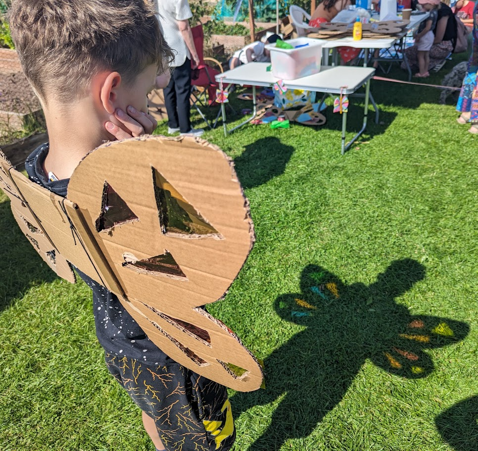 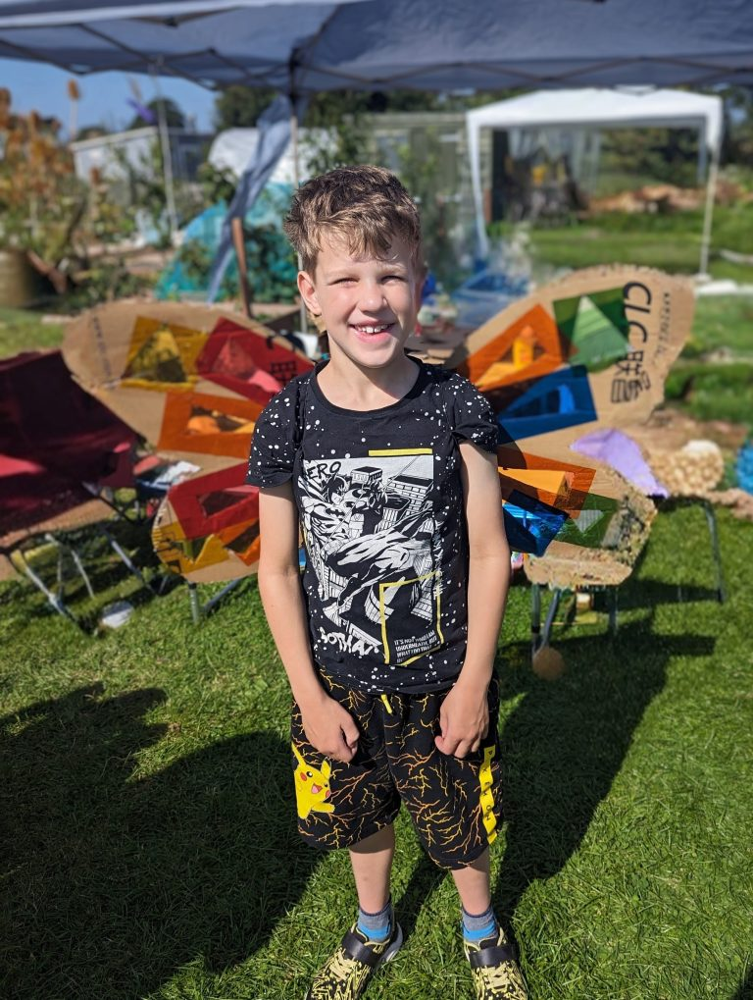 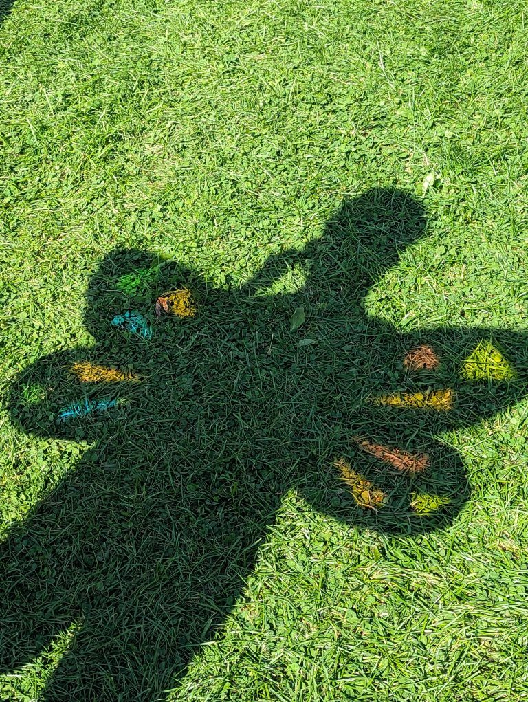 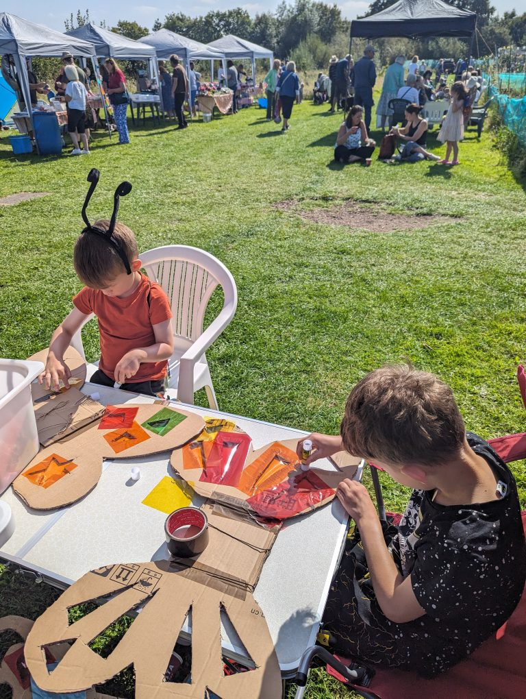 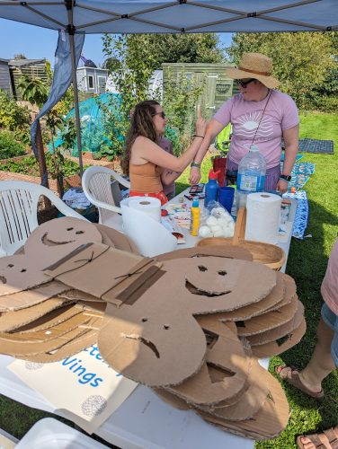 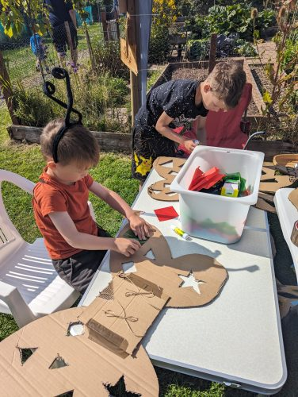 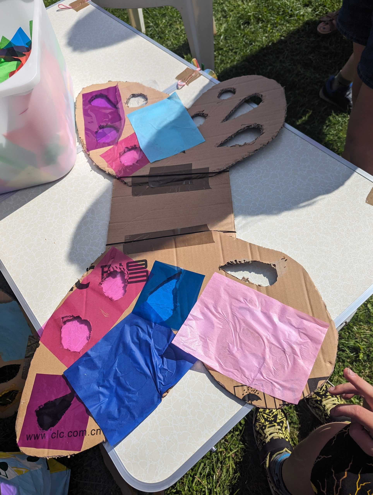
